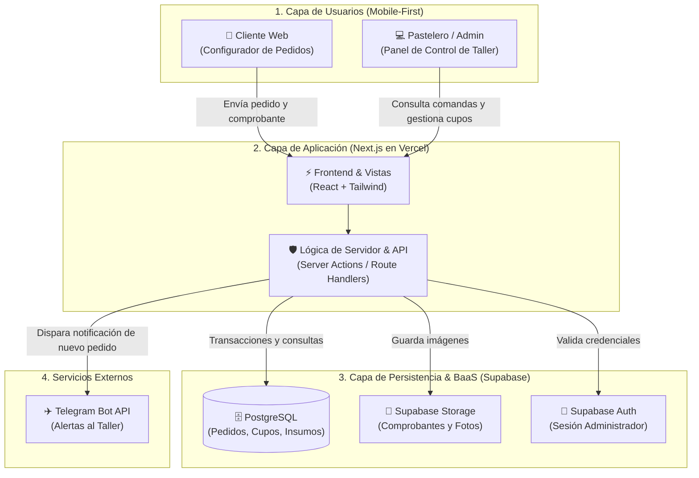
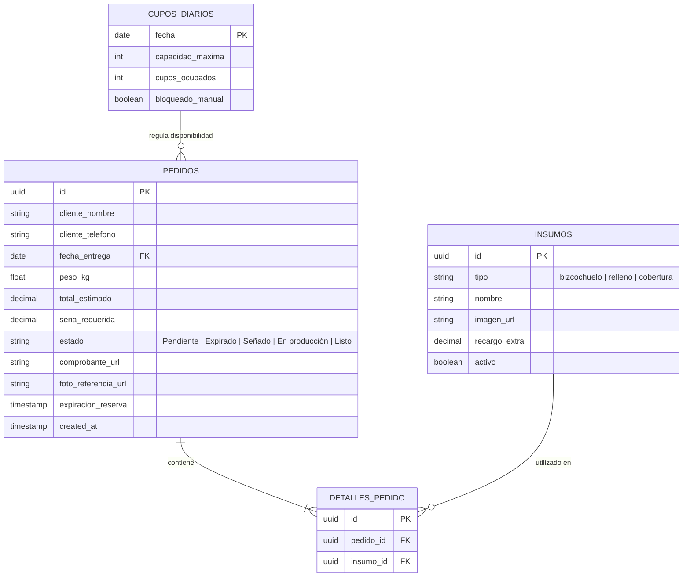

# 04 - Metodología y Arquitectura del Sistema

## 1. Elección y Justificación del Stack Tecnológico

La selección técnica busca simplificar el desarrollo unificando todo en un único lenguaje (TypeScript) y centralizando los servicios de backend:

* **Next.js (React + TypeScript):**
  * *Por qué:* Permite construir tanto la interfaz del cliente (configurador de tortas paso a paso) como el panel de administración en un solo proyecto unificado (*Full-Stack*). TypeScript evita errores en los cálculos de precios, pesos y señas.
* **Tailwind CSS:**
  * *Por qué:* Facilita el diseño *Mobile-First* adaptado a celulares de forma rápida y con bajo peso.
* **Supabase (PostgreSQL + Auth + Storage):**
  * *Por qué:* Resuelve tres necesidades críticas en una sola plataforma:
    1. **Base de Datos Relacional (PostgreSQL):** Garantiza consistencia transaccional (ACID) para evitar sobreventa de cupos si dos clientes intentan reservar la misma fecha en simultáneo.
    2. **Storage:** Permite almacenar de forma segura las fotos de comprobantes de transferencia y fotos de referencia de decoración.
    3. **Autenticación:** Protege el acceso al panel administrativo del taller sin programar un sistema de autenticación desde cero.
* **Telegram Bot API:**
  * *Por qué:* Notifica al instante al pastelero ante nuevos pedidos y avisa al cliente cuando su seña fue aprobada, sin los costos ni trabas comerciales de la API de WhatsApp.
* **Vercel:**
  * *Por qué:* Plataforma de despliegue continuo vinculada a GitHub que publica automáticamente los cambios de forma gratuita.

---

## 2. Diagrama de Arquitectura del Sistema

Muestra los componentes principales del sistema y cómo se comunican entre sí:

---

## 3. Modelo de Datos (Diagrama Entidad-Relación)

Estructura de tablas principales en PostgreSQL para soportar la lógica de cotización, cupos y comandas:

---

## 4. Metodología de Trabajo

* **Metodología Ágil (Kanban):** Tablero visual de tareas (*Backlog*, *En desarrollo*, *Testing*, *Completado*) con avance incremental.
* **Control de Versiones (GitHub Flow):** Rama `main` para producción y ramas `feature/nombre-modulo` para cada funcionalidad.
* **Fases de Desarrollo:**
  1. **Fase 1 (Fundaciones):** Configuración de Supabase (tablas, storage, auth) y scaffolding de Next.js.
  2. **Fase 2 (Flujo Cliente):** Constructor de tortas en 3 pasos, validación de cupos y subida de comprobantes.
  3. **Fase 3 (Panel Taller):** Gestión de comandas, validación de señas, bloqueo de cupos y tarifario.
  4. **Fase 4 (Notificaciones & Deploy):** Integración con Telegram Bot API y publicación en Vercel.
