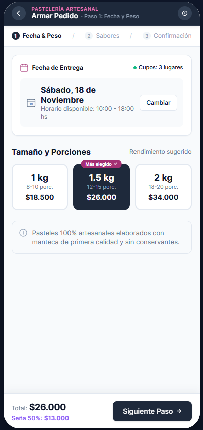
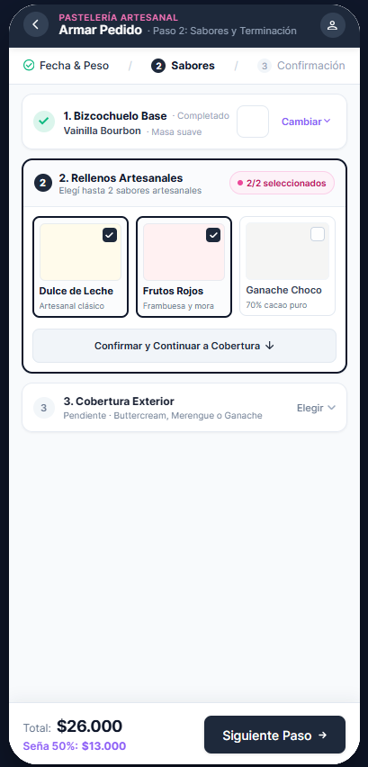
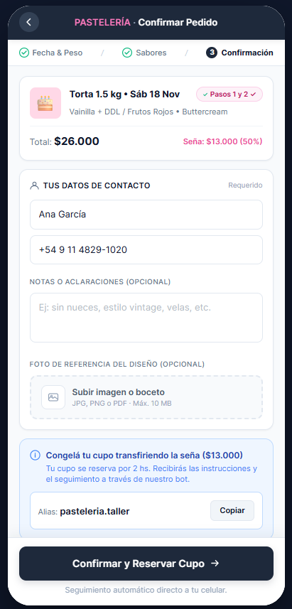
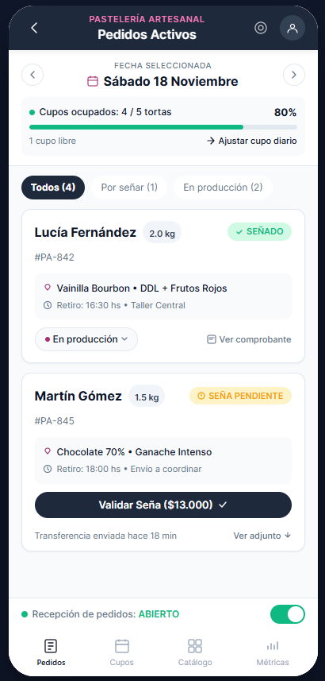
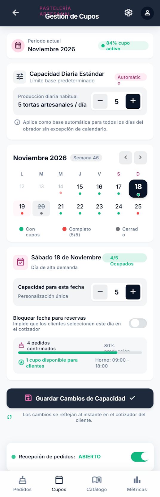
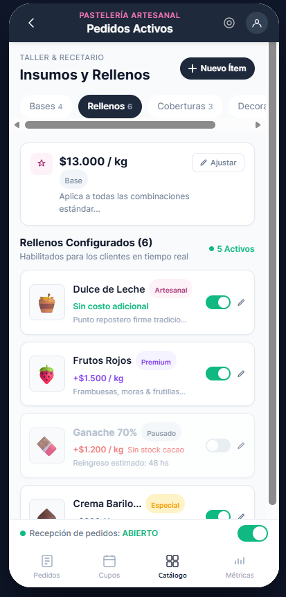
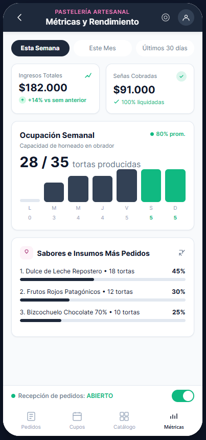

# 04 - Arquitectura Visual y Prototipo de Interfaz (Mockups)

> **Prototipo Interactivo Navegable:**  
> [Ver y probar prototipo en Figma](https://www.figma.com/make/Wp04wzTJ50wfd8wJXp4Amq/Prototipo-de-pantallas?t=Bh26kAapyL9rnE35-20&fullscreen=1)
> * [Prototipo Exploratorio Inicial / Versión Antigua (Stitch)](https://stitch.withgoogle.com/preview/16141327618063099485?node-id=8821e23528da4905863aba7a7c3440f4)

El diseño de interfaz fue proyectado bajo un enfoque estricto **Mobile-First**, optimizando la densidad de información, la legibilidad y la reducción de fricción en la toma de pedidos.

A continuación se documentan las pantallas finales estructuradas en dos módulos operativos, vinculadas formalmente con los objetivos específicos del proyecto.

---

## Módulo 1: Flujo de Cotización y Reserva (Cliente)

### 1.1 Portada y Acceso Principal (`/`)

* **Objetivo Asociado:** `OE 1 (Personalización y Cotización)`.
* **Descripción:** Pantalla de bienvenida con propuesta de valor clara (*"Tortas personalizadas a tu medida"*), microcopy aclaratorio sobre la confirmación mediante seña del 50%, chips informativos clave (fechas en tiempo real, opciones desde 1 kg, avisos automatizados) y acceso directo al flujo mediante el CTA principal.

### 1.2 Selección de Fecha y Peso (`/pedido/paso-1`)

* **Objetivo Asociado:** `OE 1 (Personalización y Cotización)` y `OE 2 (Control de Capacidad y Demanda)`.
* **Descripción:** Selector de fecha de entrega con validación de cupos en vivo y tarjetas de selección de peso base con porciones sugeridas. Incluye barra fija inferior con el total acumulado y el desglose de la seña requerida.

### 1.3 Selección de Sabores y Rellenos (`/pedido/paso-2`)

* **Objetivo Asociado:** `OE 1 (Personalización y Cotización)`.
* **Descripción:** Configuración guiada por etapas mediante componentes colapsables. Toda la navegación de avance se centraliza en el botón de acción inferior.

### 1.4 Resumen, Contacto y Transferencia (`/pedido/paso-3`)

* **Objetivo Asociado:** `OE 1 (Personalización y Cotización)` y `OE 4 (Comunicación Asíncrona)`.
* **Descripción:** Resumen consolidado del pedido, formulario de datos de contacto, notas adicionales, contenedor para adjuntar comprobante de transferencia o imagen de referencia, datos bancarios con botón de copia rápida de alias/CBU y reserva temporal de cupo por 2 horas.

---

## Módulo 2: Panel Administrativo de Taller (Operador)

### 2.1 Gestión Diaria de Comandas (`/admin/pedidos`)

* **Objetivo Asociado:** `OE 3 (Gestión Operativa de Taller)`.
* **Descripción:** Tablero de control de pedidos en curso, indicador de cupos diarios con barra de porcentaje, conmutador maestro de recepción, tarjetas individuales por comanda con filtros de estado y acción rápida para validación de señas.

### 2.2 Gestión de Cupos y Capacidad (`/admin/cupos`)

* **Objetivo Asociado:** `OE 2 (Control de Capacidad y Demanda)`.
* **Descripción:** Configuración de capacidad diaria estándar, mini calendario semanal con semáforo de disponibilidad y selector puntual por fecha con interruptor para bloqueo preventivo de reservas.

### 2.3 Tarifario y Gestión de Catálogo (`/admin/catalogo`)

* **Objetivo Asociado:** `OE 1 (Personalización y Cotización)` y `OE 3 (Gestión Operativa de Taller)`.
* **Descripción:** Ajuste del precio base por kilo ($13.000 / kg), navegación por pestañas de insumos, administración de recargos adicionales e interruptores inmediatos para pausar ingredientes sin stock.

### 2.4 Tablero Analítico (`/admin/analitica`)

* **Objetivo Asociado:** `OE 5 (Analítica y Rendimiento)`.
* **Descripción:** Métricas de rendimiento del negocio: balance de facturación total proyectada frente a señas cobradas, gráfico de ocupación semanal del taller y ranking de insumos más solicitados para previsión de compras.