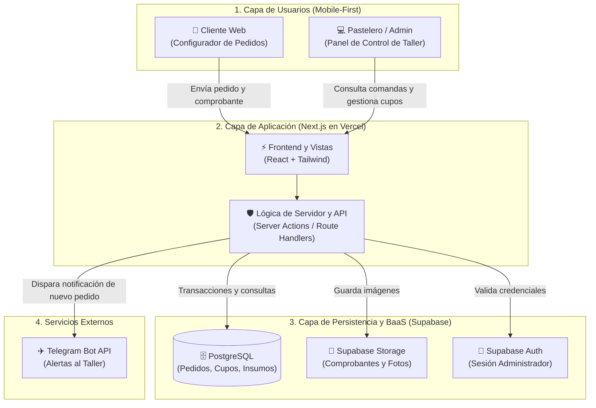
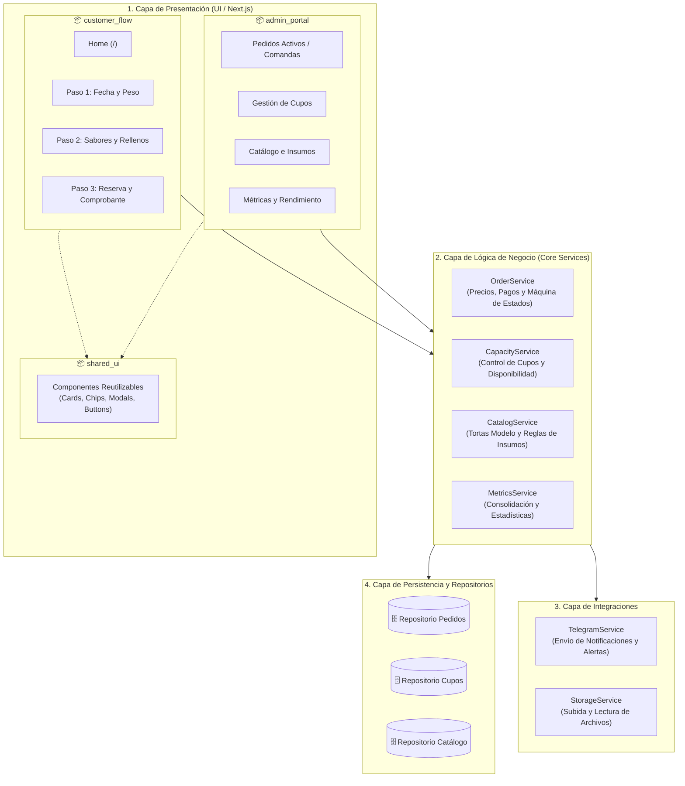
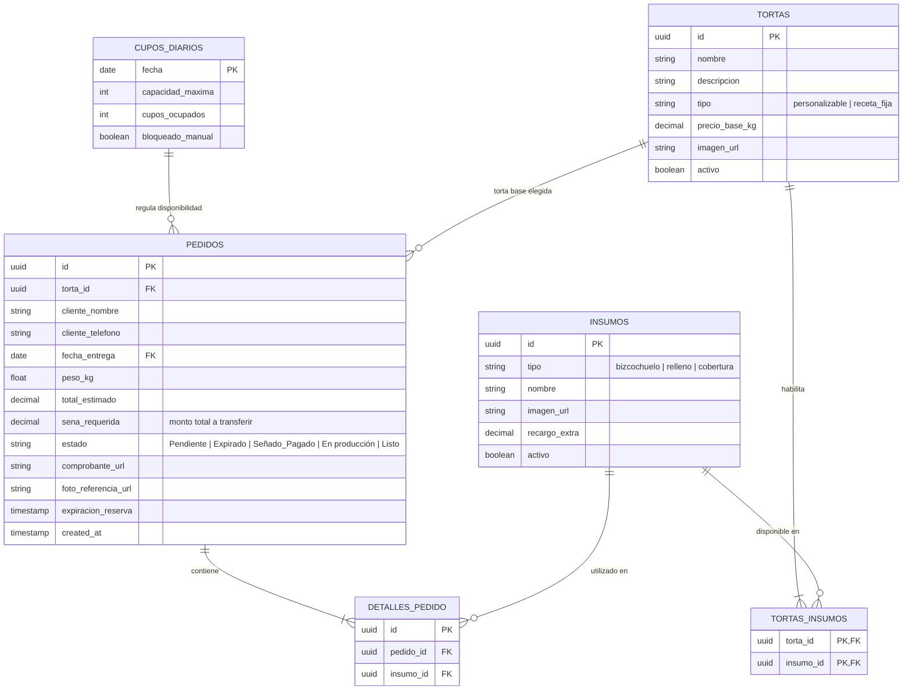

# 05 - Metodología y Arquitectura del Sistema

## 1. Elección y Justificación del Stack Tecnológico

La selección técnica busca simplificar el desarrollo unificando todo en un único lenguaje (TypeScript) y centralizando los servicios de backend:

* **Next.js (React + TypeScript):**
  * *Por qué:* Permite construir tanto la interfaz del cliente (configurador de tortas paso a paso) como el panel de administración en un solo proyecto unificado (*Full-Stack*). TypeScript evita errores en los cálculos de precios, pesos y presupuestos.
* **Tailwind CSS:**
  * *Por qué:* Facilita el diseño *Mobile-First* adaptado a celulares de forma rápida y con bajo peso.
* **Supabase (PostgreSQL + Auth + Storage):**
  * *Por qué:* Resuelve tres necesidades críticas en una sola plataforma:
    1. **Base de Datos Relacional (PostgreSQL):** Garantiza consistencia transaccional (ACID) para evitar sobreventa de cupos si dos clientes intentan reservar la misma fecha en simultáneo.
    2. **Storage:** Permite almacenar de forma segura las fotos de comprobantes de transferencia y fotos de referencia de decoración.
    3. **Autenticación:** Protege el acceso al panel administrativo del taller sin programar un sistema de autenticación desde cero.
* **Telegram Bot API:**
  * *Por qué:* Notifica al instante al pastelero ante nuevos pedidos y avisa al cliente cuando su comprobante fue aprobado, sin los costos ni trabas comerciales de la API de WhatsApp.
* **Vercel:**
  * *Por qué:* Plataforma de despliegue continuo vinculada a GitHub que publica automáticamente los cambios de forma gratuita.

---

## 2. Diagrama de Arquitectura del Sistema

Representa la distribución física y lógica de los componentes de la solución, sus roles operativos y las fronteras de comunicación:

### Explicación Técnica de la Arquitectura

* **Capa de Usuarios (Clientes):** Define los dos perfiles de interacción. El cliente final accede a una SPA/PWA responsiva optimizada para navegación móvil, mientras que el pastelero opera un panel de control administrativo para despacho y planificación.
* **Capa de Aplicación (Next.js en Vercel):** Implementa un modelo *Full-Stack unificado*. El frontend renderiza vistas reactivas, mientras que la capa de servidor (*Server Actions* y *Route Handlers*) procesa las mutaciones, valida datos con esquemas estrictos y actúa como barrera de seguridad hacia los servicios de datos.
* **Capa de Persistencia y BaaS (Supabase):** 
  * *PostgreSQL:* Gestiona el estado transaccional (ACID) del negocio (pedidos, registro de pagos por transferencia, bloqueo de cupos de producción).
  * *Storage:* Bucket dedicado para el resguardo de imágenes de referencia y comprobantes de pago.
  * *Auth:* Mecanismo de autenticación basado en JWT para restringir el acceso al portal de administración.
* **Servicios Externos (Telegram Bot API):** Canal de mensajería asíncrono desacoplado del ciclo de renderizado web, utilizado como sistema de eventos *push* para alertar al taller de nuevas solicitudes en tiempo real sin costos adicionales.

---

## 3. Diagrama de Paquetes y Modularización del Sistema

Define la organización interna del código fuente, delimitando responsabilidades, contratos de interfaz y dependencias entre capas:

### Explicación Técnica de la Estructura de Paquetes

* **Capa de Presentación (`UI`):** Organizada bajo el principio de separación por dominio de usuario:
  * `customer_flow`: Agrupa las rutas y controladores del flujo guiado de compra, manteniendo un estado local ligero enfocado en la experiencia de usuario.
  * `admin_portal`: Contiene los paneles operativos del taller (gestión de comandas, bloqueo de calendario y análisis de producción).
  * `shared_ui`: Paquete transversal que provee componentes atómicos y reutilizables, asegurando consistencia visual sin introducir acoplamiento de negocio.
* **Capa de Lógica de Negocio (`Core Services`):** Centraliza las reglas de dominio del sistema para evitar duplicación de lógica entre vistas:
  * `OrderService`: Coordina la creación del pedido, el cálculo determinístico de importes y la transición entre estados (*Pendiente*, *Confirmado*, *En producción*, *Listo*).
  * `CapacityService`: Aplica las validaciones de límite diario de producción antes de autorizar una reserva.
  * `CatalogService`: Administra el catálogo de tortas modelo (precios base por kg, tipología personalizable vs receta fija) y las matrices de insumos compatibles habilitados.
  * `MetricsService`: Consolida indicadores de demanda agregada, porcentajes de ocupación de taller y balance financiero de facturación y cobranzas.
* **Capa de Integraciones (`Integrations`):** Actúa como patrón *Adapter*, aislando a los servicios de dominio de los SDKs de terceros (Supabase Storage y Telegram Bot API). Si un proveedor cambia, únicamente se modifica el adaptador correspondiente.
* **Capa de Persistencia y Repositorios (`Data`):** Encapsula el acceso a las entidades de base de datos relacional mediante consultas tipadas, garantizando integridad referencial y facilitando la migración o mockeo en pruebas.

## 4. Diagrama de Entidad-Relación (Modelo de Datos)

### Explicación Técnica de las Entidades y Relaciones

* **`TORTAS`:** Modela el catálogo de productos comerciales del taller. Define la tarifa base por kilo (`precio_base_kg`) y la estrategia de elaboración (`tipo`): *personalizable* (receta abierta con selección dinámica de capas) o *receta_fija* (fórmula estándar tradicional).
* **`TORTAS_INSUMOS`:** Tabla de unión de muchos a muchos que implementa la matriz de compatibilidad, restringiendo qué bizcochuelos, rellenos o coberturas del catálogo general pueden seleccionarse para cada torta específica.
* **`PEDIDOS`:** Entidad transaccional central. Asocia la torta modelo solicitada (`torta_id`), el peso parametrizado, los importes calculados y el control de estados del taller, vinculada con la fecha de producción en `CUPOS_DIARIOS`.
* **`DETALLES_PEDIDO` e `INSUMOS`:** Normaliza los ingredientes puntuales elegidos por el cliente para la elaboración de la torta personalizada.
